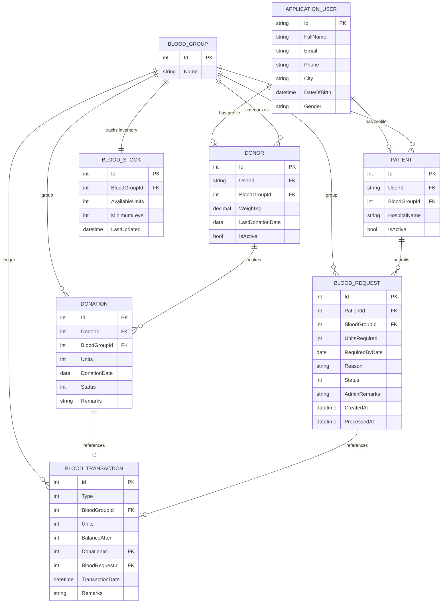
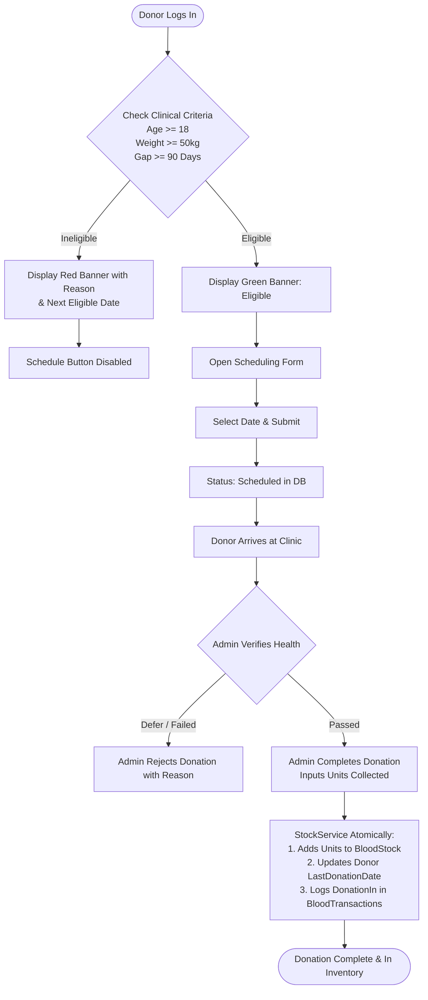
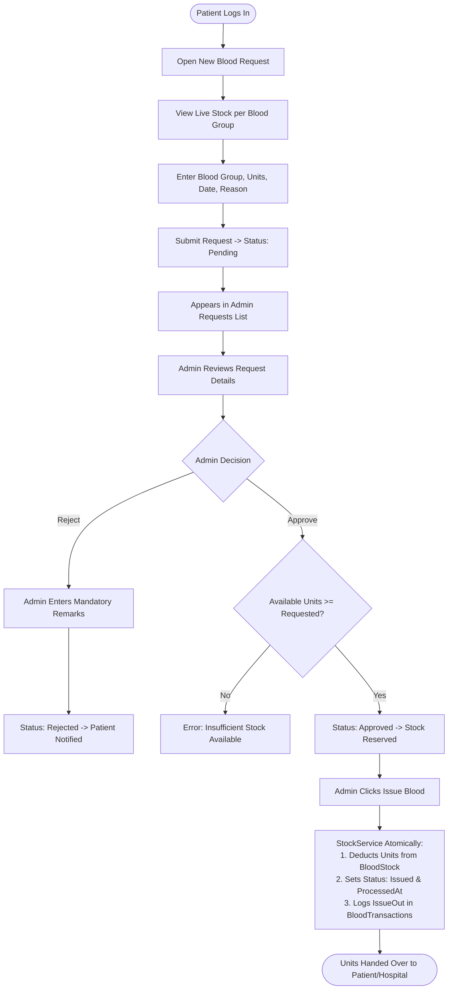

# Software Requirements Specification (SRS)
## Blood Bank Management System (BBMS)

**Document Version:** 1.0  
**Date:** October 2026  
**Status:** Approved / Implemented  
**Technology:** ASP.NET Core MVC (.NET 8/10) · Entity Framework Core · SQLite · ASP.NET Core Identity · Pure CSS  
**Repository:** [https://github.com/janakgadhiya/Blood-Bank](https://github.com/janakgadhiya/Blood-Bank)

---

## 1. Project Description Page

### 1.1 Executive Summary
The **Blood Bank Management System (BBMS)** is an automated, web-based enterprise healthcare application designed to bridge the operational communication gap between blood donors, medical patients, and hospital blood bank administrators. 

In conventional healthcare environments, tracking blood donations, inventory levels, and patient requisitions manually leads to severe inefficiencies, including lost donor histories, delayed responses to emergency transfusions, inventory record mismatches, and expired or untracked blood supplies. 

The BBMS system resolves these pain points through a centralized, role-based platform that enforces automated donor eligibility verification, real-time multi-group inventory tracking, direct patient request handling, and an immutable double-entry audit ledger for all blood transactions.

### 1.2 System Context
The application operates as a standalone or hospital-integrated web portal. It features public transparency modules (real-time blood availability), self-service user portals for registered Donors and Patients, and an administrative control center for clinical staff.

```
       +-----------------------------------------------------------------+
       |                  Hospital Blood Bank System                     |
       +-----------------------------------------------------------------+
          |                               |                           |
          v                               v                           v
  +---------------+               +---------------+           +---------------+
  |  Donor Portal |               | Patient Portal|           |  Admin Portal |
  | - Registration|               | - Blood Req.  |           | - Stock Mgmt  |
  | - Eligibility |               | - Status Track|           | - Request Appr|
  | - History     |               | - Profile     |           | - Audit Ledger|
  +---------------+               +---------------+           +---------------+
          |                               |                           |
          +-------------------------------+---------------------------+
                                          |
                                          v
                         +---------------------------------+
                         |  Central SQLite Database Engine |
                         |  (EF Core 8 / Identity / Ledger)|
                         +---------------------------------+
```

---

## 2. Project Objectives

1. **Automate Inventory Balancing:** Eliminate paper ledgers by maintaining computerized real-time stock levels for all standard blood groups (A+, A-, B+, B-, AB+, AB-, O+, O-).
2. **Safeguard Donor Health & Clinical Compliance:** Enforce clinical donor deferral protocols automatically (age $\ge$ 18, weight $\ge$ 50 kg, and a minimum 90-day interval between donations).
3. **Streamline Emergency Requisitions:** Allow registered patients and clinics to submit blood requests online with real-time stock availability visibility.
4. **Enforce Complete Audit Accountability:** Log every stock change (donation, issuance, manual adjustment) permanently into an append-only, immutable transaction ledger.
5. **Zero External Frontend Dependencies:** Ensure complete independence from heavy, vulnerable third-party JavaScript/CSS frameworks (Bootstrap, jQuery, Chart.js) by utilizing pure, lightweight, responsive semantic HTML5 and hand-crafted CSS.
6. **Future-Proof Database Portability:** Architect all data access via Entity Framework Core Code-First to enable instant migration from SQLite to Microsoft SQL Server with minimal configuration changes.

---

## 3. Technology Stack & Architecture

### 3.1 Technology Stack Matrix

| Layer | Technology | Specification / Details |
|---|---|---|
| **Programming Language** | C# 12 / 13 | Strong typing, async/await, modern pattern matching |
| **Framework** | ASP.NET Core MVC | Target: .NET 8 / .NET 10 |
| **Object-Relational Mapping** | Entity Framework Core 8 | Code-First migrations, strict navigation mapping, LINQ queries |
| **Database** | SQLite 3 | Embedded single-file database (`bloodbank.db`), zero installation required |
| **Authentication & Authorization**| ASP.NET Core Identity | Cookie-based auth, PBKDF2 password hashing, Role-Based Access Control (RBAC) |
| **Frontend Architecture** | Razor Views (.cshtml) | Server-rendered semantic HTML5, Tag Helpers |
| **Stylesheets & UI Theme** | Hand-crafted Pure CSS | Medical Red (`#C62828`) theme, CSS Grid, Flexbox, Status Badges (`site.css`) |
| **UI Frameworks** | None | No Bootstrap, No jQuery, No Chart.js, No React/Angular (pure zero-dependency) |
| **Version Control** | Git & GitHub | Branch: `main`, commit checkpoints per phase |

### 3.2 Software Architecture
The solution adheres to the **Model-View-Controller (MVC)** architectural design with an auxiliary **Service Layer**:
- **Controllers:** Handle HTTP requests, model binding, and authorization filters (`[Authorize(Roles = "...")]`).
- **Data Access:** Directly utilizes `ApplicationDbContext` for standard CRUD operations to eliminate repository pattern over-abstraction.
- **Service Layer (`StockService` & `EligibilityService`):** Encapsulates critical business logic, atomic inventory operations, database transactions, and health checks.
- **Views:** Strongly-typed Razor templates with anti-forgery token protection on all POST forms.

---

## 4. User Roles & Descriptions

The system recognizes four distinct user roles, each isolated with specific authorization policies:

| Role | Description | Access Level & Permissions |
|---|---|---|
| **Guest / Anonymous** | Public visitor without an authenticated account | - View landing page & real-time blood stock counts.<br>- Search availability by blood group (donor privacy strictly protected).<br>- Register as a Donor or Patient.<br>- Log in to existing account. |
| **Donor** | An individual willing to donate whole blood | - Access Donor Dashboard.<br>- View clinical eligibility status and next eligible donation date.<br>- Schedule prospective blood donation appointments.<br>- View personal donation history and cancel pending appointments.<br>- Update donor profile (weight, blood group, contact info). |
| **Patient** | A patient, relative, or clinic requiring blood units | - Access Patient Dashboard.<br>- Submit new blood requisitions with live inventory reference.<br>- Track status of requisitions (Pending, Approved, Issued, Rejected, Cancelled).<br>- Review administrative remarks.<br>- Cancel own pending requests.<br>- Update patient facility profile. |
| **Administrator** | Hospital blood bank medical staff or manager | - Access Central Admin Dashboard with live KPI cards and low-stock alerts.<br>- Manage blood inventory levels and execute manual stock corrections.<br>- Record walk-in blood donations with on-the-fly eligibility checks.<br>- Complete, reject, or cancel scheduled donor visits.<br>- Review, approve, reject (mandatory remarks), and issue blood requests.<br>- Inspect immutable audit transaction ledger.<br>- Manage donor and patient directories (search, filter, activate/deactivate).<br>- Manage blood group nomenclature. |

---

## 5. Functional Features & System Modules

### 5.1 Authentication & Profile Module
- **Role Selection Registration:** Registration form dynamically displays Donor-specific fields (Weight in kg) or Patient-specific fields (Hospital/Facility name) without page reload.
- **Role-Based Redirection:** Automatic redirection upon login based on user claims:
  - Admin $\rightarrow$ `/Admin/Dashboard`
  - Donor $\rightarrow$ `/Donor/Dashboard`
  - Patient $\rightarrow$ `/Patient/Dashboard`
- **Ownership Security:** Donors and Patients can only access, view, or cancel their own records. URL ID tampering attempts return a 403 Forbidden or friendly access error.

### 5.2 Public Transparency & Search Module
- **Live Inventory Cards:** Eight dynamic cards displaying current available units and colored status indicators:
  - **Available:** Stock above minimum alert threshold (Green).
  - **Low Stock:** Stock at or below minimum alert threshold (Orange/Red).
  - **Out of Stock:** 0 units available (Dark Red).
- **Search Without PII Exposure:** Public search by blood group returns stock counts without exposing donor identities or phone numbers.

### 5.3 Donor Portal & Clinical Eligibility Engine
- **Three-Pillar Eligibility Engine:** Evaluates donor compliance from `appsettings.json`:
  $$\text{Age} \ge 18 \quad \land \quad \text{Weight} \ge 50\,\text{kg} \quad \land \quad (\text{Today} - \text{LastDonationDate}) \ge 90\,\text{days}$$
- **Dynamic Deferral Diagnostic:** If ineligible, the dashboard displays the exact clinical reason and calculates the exact date when the donor will next be eligible.
- **Appointment Booking:** Allows eligible donors to schedule upcoming visits. Ineligible scheduling is blocked.

### 5.4 Patient Requisition Module
- **Interactive Submission Form:** Requisition form displays blood group, units required (1–50), required-by date (must not be in the past), and clinical reason.
- **Live Reference Indicator:** Side-by-side inventory panel shows units currently in stock for the selected blood group.
- **Self-Service Cancellation:** Patients can cancel their request while it remains in `Pending` status.

### 5.5 Admin Inventory Management (`StockService`)
- **Atomic Transactional Balance:** All stock deductions and additions are wrapped in a single database transaction (`BeginTransactionAsync`), guaranteeing that stock balances and audit transactions never disagree.
- **Floor Guard:** Stock values are mathematically prevented from falling below zero.
- **Manual Adjustment:** Allows authorized staff to correct inventory counts (e.g. damaged bags), requiring a mandatory justification reason.

### 5.6 Admin Request Fulfillment Workflow
- **Standard Chronological Queue:** Requests are ordered chronologically (newest first).
- **Two-Step Fulfillment:**
  - **Approve:** Verifies stock $\ge$ requested units and reserves request.
  - **Issue:** Atomically deducts units from stock, updates status to `Issued`, stamps `ProcessedAt`, and creates an `IssueOut` ledger transaction.
  - **Reject:** Mandates administrative remarks describing the reason for refusal.

### 5.7 Immutable Audit Ledger Module
- **Append-Only Table:** `BloodTransactions` records cannot be updated or deleted through any controller or UI view.
- **Balance Verification:** Every row records `Type` (`DonationIn`, `IssueOut`, `Adjustment`), `Units`, `BalanceAfter`, timestamp, and relational foreign keys.

---

## 6. Non-Functional Requirements

### 6.1 Security Requirements
- **Password Security:** ASP.NET Core Identity uses PBKDF2 hashing with HMAC-SHA256 and salted hashes.
- **CSRF Protection:** Form Tag Helpers generate and validate Anti-Forgery Tokens (`[ValidateAntiForgeryToken]`) across all HTTP POST endpoints.
- **Authorization Guardrails:** Administrative routes are prefixed with `/Admin/` and protected with `[Authorize(Roles = "Admin")]`.
- **Soft Deactivation:** Clinical records are deactivated (`IsActive = false`) rather than deleted, preserving medical audit trails.

### 6.2 Usability & Styling
- **Medical Theme:** Primary brand accent `#C62828` with `#8E0000` hover accents, clean white cards, and accessible typography.
- **Status Pills:** Color-coded badges for states:
  - `Pending`: Yellow badge
  - `Approved`: Blue badge
  - `Issued` / `Completed`: Green badge
  - `Rejected`: Red badge
  - `Cancelled`: Gray badge
- **Responsive Layout:** Responsive CSS Grid adjusting smoothly from desktop multi-column to single-column mobile viewports via `@media (max-width: 768px)`.

---

## 7. Data Tables & Database Schema

The database consists of 8 core application tables integrated with ASP.NET Core Identity tables:

### 7.1 Table: `AspNetUsers` (`ApplicationUser`)
Represents the core identity account for every user in the system.

| Column | Data Type | Nullable | Constraints / Notes |
|---|---|---|---|
| `Id` | TEXT | No | Primary Key (GUID string) |
| `UserName` | TEXT | No | Unique email address |
| `NormalizedUserName` | TEXT | No | Normalized uppercase |
| `Email` | TEXT | No | User email address |
| `NormalizedEmail` | TEXT | No | Normalized uppercase email |
| `PasswordHash` | TEXT | Yes | PBKDF2 hashed password |
| `SecurityStamp` | TEXT | Yes | Token security stamp |
| `FullName` | TEXT (100) | No | Full legal name of user |
| `Phone` | TEXT (20) | No | Primary phone contact |
| `PhoneNumber` | TEXT | Yes | Identity phone mapping |
| `City` | TEXT (100) | No | Residential/operating city |
| `DateOfBirth` | TEXT (Date) | No | Date of birth for age eligibility |
| `Gender` | TEXT (20) | No | Male / Female / Other |

### 7.2 Table: `BloodGroups`
Stores the standard blood groups seeded into the system.

| Column | Data Type | Nullable | Constraints / Notes |
|---|---|---|---|
| `Id` | INTEGER | No | Primary Key (Auto-Increment) |
| `Name` | TEXT (10) | No | Unique blood type (A+, A-, B+, B-, AB+, AB-, O+, O-) |

### 7.3 Table: `BloodStocks`
Tracks the current inventory count and warning threshold for each blood group.

| Column | Data Type | Nullable | Constraints / Notes |
|---|---|---|---|
| `Id` | INTEGER | No | Primary Key (Auto-Increment) |
| `BloodGroupId` | INTEGER | No | Unique Foreign Key $\rightarrow$ `BloodGroups.Id` |
| `AvailableUnits` | INTEGER | No | Current units in stock ($\ge 0$) |
| `MinimumLevel` | INTEGER | No | Alert threshold (Defaults to 10) |
| `LastUpdated` | TEXT (DateTime) | No | UTC timestamp of last inventory change |

### 7.4 Table: `Donors`
Stores donor-specific medical attributes and eligibility tracking.

| Column | Data Type | Nullable | Constraints / Notes |
|---|---|---|---|
| `Id` | INTEGER | No | Primary Key (Auto-Increment) |
| `UserId` | TEXT | No | Foreign Key $\rightarrow$ `AspNetUsers.Id` (DeleteBehavior.Restrict) |
| `BloodGroupId` | INTEGER | No | Foreign Key $\rightarrow$ `BloodGroups.Id` |
| `WeightKg` | NUMERIC (5,2) | No | Body weight in kilograms (Min 50 kg to donate) |
| `LastDonationDate` | TEXT (Date) | Yes | Date of most recent completed donation |
| `IsActive` | INTEGER (Boolean) | No | Account status flag (1 = Active, 0 = Deactivated) |

### 7.5 Table: `Patients`
Stores patient and medical facility contact records.

| Column | Data Type | Nullable | Constraints / Notes |
|---|---|---|---|
| `Id` | INTEGER | No | Primary Key (Auto-Increment) |
| `UserId` | TEXT | No | Foreign Key $\rightarrow$ `AspNetUsers.Id` (DeleteBehavior.Restrict) |
| `BloodGroupId` | INTEGER | No | Foreign Key $\rightarrow$ `BloodGroups.Id` |
| `HospitalName` | TEXT (150) | No | Name of hospital, clinic, or room number |
| `IsActive` | INTEGER (Boolean) | No | Account status flag (1 = Active, 0 = Deactivated) |

### 7.6 Table: `Donations`
Records scheduled donor visits and completed walk-in donations.

| Column | Data Type | Nullable | Constraints / Notes |
|---|---|---|---|
| `Id` | INTEGER | No | Primary Key (Auto-Increment) |
| `DonorId` | INTEGER | No | Foreign Key $\rightarrow$ `Donors.Id` |
| `BloodGroupId` | INTEGER | No | Foreign Key $\rightarrow$ `BloodGroups.Id` |
| `Units` | INTEGER | No | Whole blood units collected |
| `DonationDate` | TEXT (Date) | No | Date scheduled or recorded |
| `Status` | INTEGER (Enum) | No | 0=Scheduled, 1=Completed, 2=Rejected, 3=Cancelled |
| `Remarks` | TEXT (500) | Yes | Clinical observations or notes |

### 7.7 Table: `BloodRequests`
Stores blood requisitions submitted by patients or clinics.

| Column | Data Type | Nullable | Constraints / Notes |
|---|---|---|---|
| `Id` | INTEGER | No | Primary Key (Auto-Increment) |
| `PatientId` | INTEGER | No | Foreign Key $\rightarrow$ `Patients.Id` |
| `BloodGroupId` | INTEGER | No | Foreign Key $\rightarrow$ `BloodGroups.Id` |
| `UnitsRequired` | INTEGER | No | Units requested (Range: 1–50) |
| `Urgency` | INTEGER (Enum) | No | 0=Normal, 1=Urgent, 2=Critical |
| `RequiredByDate` | TEXT (Date) | No | Deadline date (cannot be in past) |
| `Reason` | TEXT (500) | No | Medical indication / treatment reason |
| `Status` | INTEGER (Enum) | No | 0=Pending, 1=Approved, 2=Rejected, 3=Issued, 4=Cancelled |
| `AdminRemarks` | TEXT (500) | Yes | Administrative notes (required on rejection) |
| `CreatedAt` | TEXT (DateTime) | No | Submission timestamp (UTC) |
| `ProcessedAt` | TEXT (DateTime) | Yes | Completion/Issuance timestamp (UTC) |

### 7.8 Table: `BloodTransactions`
Immutable double-entry ledger tracking all inventory modifications.

| Column | Data Type | Nullable | Constraints / Notes |
|---|---|---|---|
| `Id` | INTEGER | No | Primary Key (Auto-Increment) |
| `Type` | INTEGER (Enum) | No | 0=DonationIn, 1=IssueOut, 2=Adjustment |
| `BloodGroupId` | INTEGER | No | Foreign Key $\rightarrow$ `BloodGroups.Id` |
| `Units` | INTEGER | No | Count delta (+ to add, - to subtract) |
| `BalanceAfter` | INTEGER | No | Inventory balance immediately following transaction |
| `DonationId` | INTEGER | Yes | Foreign Key $\rightarrow$ `Donations.Id` (Null for non-donations) |
| `BloodRequestId` | INTEGER | Yes | Foreign Key $\rightarrow$ `BloodRequests.Id` (Null for non-issues) |
| `TransactionDate` | TEXT (DateTime) | No | UTC transaction timestamp |
| `Remarks` | TEXT (500) | Yes | Reason for change or clinical source |

---

## 8. Entity-Relationship (ER) Diagram



---

## 9. User Diagrams & System Workflows

### 9.1 Use Case Diagram (User Roles & Capabilities)

```mermaid
graph TD
    subgraph Roles
        G["Guest User"]
        D["Registered Donor"]
        P["Registered Patient"]
        A["Hospital Administrator"]
    end

    subgraph Public_Features["Public Features"]
        UC1["View Home & Stock Levels"]
        UC2["Search Blood Availability"]
        UC3["Register Account"]
        UC4["Login / Logout"]
    end

    subgraph Donor_Portal["Donor Portal"]
        UC5["View Eligibility Diagnostics"]
        UC6["Schedule Donation Visit"]
        UC7["View Personal Donation History"]
        UC8["Cancel Pending Appointment"]
        UC9["Edit Donor Profile"]
    end

    subgraph Patient_Portal["Patient Portal"]
        UC10["Submit Blood Requisition"]
        UC11["Track Requisition Status"]
        UC12["Cancel Pending Request"]
        UC13["Edit Patient Profile"]
    end

    subgraph Admin_Portal["Admin Portal"]
        UC14["View Operational Dashboard"]
        UC15["Manage Stock & Adjustments"]
        UC16["Record Walk-in Donations"]
        UC17["Complete / Reject Donations"]
        UC18["Approve / Issue / Reject Requests"]
        UC19["Audit Transaction Ledger"]
        UC20["Manage Donor / Patient Status"]
    end

    G --> UC1
    G --> UC2
    G --> UC3
    G --> UC4

    D --> UC1
    D --> UC2
    D --> UC5
    D --> UC6
    D --> UC7
    D --> UC8
    D --> UC9

    P --> UC1
    P --> UC2
    P --> UC10
    P --> UC11
    P --> UC12
    P --> UC13

    A --> UC14
    A --> UC15
    A --> UC16
    A --> UC17
    A --> UC18
    A --> UC19
    A --> UC20
```



### 9.2 Donor Donation & Eligibility Workflow



### 9.3 Patient Request & Issuance Workflow



---

## 10. Web Application Output Screenshots

*(Note: Image files can be placed in `Docs/Screenshots/` and embedded directly using markdown syntax ``)*

### 10.1 Home Page & Live Blood Availability Cards
Landing page displaying system introduction and real-time inventory cards for all 8 blood groups (Available, Low Stock, Out of Stock).

```
+-----------------------------------------------------------------------------------+
|  🩸 BloodBank           Home   Search Blood   Login   Register                    |
+-----------------------------------------------------------------------------------+
|                                                                                   |
|                           Save Lives, Donate Blood                                |
|   Connecting blood donors with patients in real-time. Check live blood group      |
|               availability below or register today.                               |
|                                                                                   |
|           [ Search Available Blood ]      [ Become a Donor ]                      |
|                                                                                   |
|   Live Blood Group Stock Levels:                                                  |
|   +--------------+  +--------------+  +--------------+  +--------------+          |
|   |   Group A+   |  |   Group A-   |  |   Group B+   |  |   Group B-   |          |
|   |   3 units    |  |   0 units    |  |   0 units    |  |   0 units    |          |
|   | [ LOW STOCK] |  | [OUT OF STK] |  | [OUT OF STK] |  | [OUT OF STK] |          |
|   +--------------+  +--------------+  +--------------+  +--------------+          |
|   +--------------+  +--------------+  +--------------+  +--------------+          |
|   |  Group AB+   |  |  Group AB-   |  |   Group O+   |  |   Group O-   |          |
|   |   0 units    |  |   0 units    |  |   2 units    |  |   0 units    |          |
|   | [OUT OF STK] |  | [OUT OF STK] |  | [ LOW STOCK] |  | [OUT OF STK] |          |
|   +--------------+  +--------------+  +--------------+  +--------------+          |
+-----------------------------------------------------------------------------------+
```
> **[ Screenshot Placeholder 10.1: Home Page & Blood Availability Cards ]**  
> ``

---

### 10.2 Public Blood Search Page
Allows anonymous visitors to select any blood group from a dropdown and verify current stock counts without displaying sensitive donor data.

> **[ Screenshot Placeholder 10.2: Blood Search Page ]**  
> ``

---

### 10.3 User Registration & Login Portal
User registration form featuring dynamic role-toggling (Donor weight input vs. Patient hospital input) and secure ASP.NET Core Identity authentication.

> **[ Screenshot Placeholder 10.3: Registration & Login ]**  
> ``

---

### 10.4 Donor Dashboard & Diagnostic Banner
Displays donor eligibility assessment banner (Green for eligible; Red for ineligible with exact reason and next eligible date), recorded weight, and key stats.

> **[ Screenshot Placeholder 10.4: Donor Dashboard ]**  
> ``

---

### 10.5 Donor Appointment Booking & History
Allows eligible donors to schedule prospective blood donation dates and view past completed donations.

> **[ Screenshot Placeholder 10.5: Donor History & Scheduler ]**  
> ``

---

### 10.6 Patient Dashboard & Request Status Tracker
Patient dashboard showing count cards for Pending, Approved, Issued, and Rejected requests alongside facility information.

> **[ Screenshot Placeholder 10.6: Patient Dashboard ]**  
> ``

---

### 10.7 Patient New Blood Request Form
Requisition form with unit selector, required-by date, clinical reason, and an adjacent real-time blood stock reference table.

> **[ Screenshot Placeholder 10.7: Patient New Request ]**  
> ``

---

### 10.8 Admin Executive Dashboard
Operational administration control center showing KPI number cards (Total Donors, Total Patients, Total Available Units, Pending Requests, Donations Today), low-stock warning table, and recent requests.

> **[ Screenshot Placeholder 10.8: Admin Dashboard ]**  
> ``

---

### 10.9 Admin Blood Requests Management
Central table listing all submitted patient blood requests with blood group, units, live stock check, status badge, and review action.

> **[ Screenshot Placeholder 10.9: Admin Requests Table ]**  
> ``

---

### 10.10 Admin Blood Stock & Manual Adjustment
Full 8-group inventory management table with minimum threshold editors and manual adjustment form with required justification reason.

> **[ Screenshot Placeholder 10.10: Admin Stock & Adjustment ]**  
> ``

---

### 10.11 Admin Donations Management
Walk-in donation logger with automated on-the-fly donor eligibility verification, scheduled donation completion, and rejection options.

> **[ Screenshot Placeholder 10.11: Admin Donations Management ]**  
> ``

---

### 10.12 Admin Immutable Transaction Ledger
Append-only audit trail logging all inventory mutations with `Tx ID`, timestamp, `Type` (`DonationIn`, `IssueOut`, `Adjustment`), `Units`, `BalanceAfter`, and `Remarks`.

> **[ Screenshot Placeholder 10.12: Transaction Ledger ]**  
> ``

---

### 10.13 Admin Donor & Patient Directories
Management tables for searching registered donors and patients by name, email, or hospital, with one-click account activation/deactivation toggles.

> **[ Screenshot Placeholder 10.13: Donor & Patient Directories ]**  
> ``

---

## 11. Final Conclusion

The **Blood Bank Management System (BBMS)** successfully replaces error-prone manual blood bank registers with a resilient, modern, and clinically aligned enterprise web solution. 

### Key Accomplishments:
1. **Clinical Accuracy & Safety:** Automated three-point eligibility diagnostics prevent premature or unsafe blood collection while providing donors with clear next-eligible date schedules.
2. **Transactional Inventory Integrity:** The centralized `StockService` and immutable `BloodTransactions` ledger ensure that physical inventory and audit records never diverge, preventing negative balances and undocumented stock changes.
3. **Streamlined Patient Requisition:** Patients can query live stock and submit requests with transparency into administrative remarks and fulfillment milestones.
4. **Clean, Lightweight Architecture:** By eschewing external CSS/JS frameworks in favor of hand-crafted CSS and native browser capabilities, the application achieves rapid page loads, low bandwidth overhead, and complete independence from third-party client dependencies.
5. **Database Extensibility:** With full Entity Framework Core Code-First encapsulation, switching the underlying database from SQLite to Microsoft SQL Server or PostgreSQL requires updating only a single connection string and configuration line.

The system is fully implemented, verified, committed to version control, and ready for deployment in hospital or community blood bank environments.
